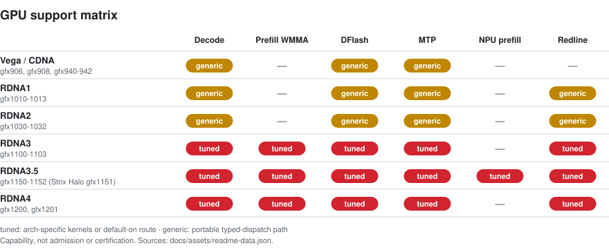

<picture>
  <source media="(prefers-color-scheme: dark)" srcset="docs/assets/hero-dark.png" />
  
</picture>

<h1 align="center">hipfire</h1>

<p align="center">
  <strong>Local LLM inference for AMD GPUs. Tuned first for RDNA, with CDNA support.</strong><br />
  Rust + HIP + Redline. No Python in the hot path. Pull, serve, chat.
</p>

<p align="center">
  <a href="https://github.com/warpfront/hipfire/releases"></a>
  <a href="CHANGELOG.md"></a>
  <a href="docs/MODELS.md"></a>
  <a href="https://discord.gg/F3BaywB8Rs"></a>
</p>

<p align="center">
  <a href="#quickstart">Quickstart</a> ·
  <a href="#whats-new-in-043">What's new</a> ·
  <a href="#models">Models</a> ·
  <a href="#gpu-support">GPU support</a> ·
  <a href="#peacemaker">PeaceMaker</a> ·
  <a href="#install">Install</a> ·
  <a href="#documentation">Docs</a>
</p>

## What hipfire is

hipfire is an inference engine for AMD GPUs. It ships its own Rust runtime,
model implementations, quantization formats (MQ3–MQ6, MQ4R, MFP4), typed
kernel dispatch and HIP kernels. ROCm is loaded dynamically. There is no
Python, PyTorch, CUDA translation layer or third-party inference engine in
the hot path.

You get a curated model registry, a CLI (`pull`, `run`, `chat`, `serve`,
`bench`, `quantize`) and an OpenAI-compatible HTTP daemon. Speculative
decoding (DFlash draft models, native MTP heads), multi-GPU expert
parallelism and the Redline replay path ship with the engine.

## Quickstart

```bash
hipfire pull qwen3.8:27b-mq4-xts
hipfire serve qwen3.8:27b-mq4-xts -d
hipfire chat qwen3.8:27b-mq4-xts
```

This downloads about 15 GB and needs a 24 GB+ card or a Strix Halo system. On
smaller cards, use `qwen3.5:4b` or `qwen3.5:9b` with the same commands.
[Pick a model for your GPU](docs/PICK-A-MODEL.md) lists recommendations for
each GPU tier.

For one-shot inference:

```bash
hipfire run qwen3.8:27b-mq4-xts "What is the capital of France?"
```

Qwen3.8-Flash (`qwen3.8:flash-next`) is a MoE model. The tag resolves to the
split base `qwen3.8-flash-next-base.mq4-xts` (about 70.9 GB), plus a shared
per-token-embedding (PLE) sidecar (29.1 GB for q4 rows, 54.4 GB for q8 rows)
and, on gfx1201, a 213 KB expert hot-set file. The old 125 GB monolith
(`qwen3.8-flash-next.mq4-xts`, formerly `qwen3.8-flash-next-gptq3.mq4`) stays
published for existing clients:

```bash
hipfire pull qwen3.8:flash-next
hipfire serve qwen3.8:flash-next -d
```

A 32 GB card alone is not enough for Qwen3.8-Flash. It needs a 128 GB Strix Halo
system, or an R9700 with enough host RAM for the mapped experts, or two
R9700s (EP2). Native context is 262K tokens, subject to available memory.

Image generation (RDNA3/3.5 measured):

```bash
hipfire pull flux.schnell:1
hipfire img --out x.png flux.schnell:1 "a red cube on a wooden table"
```

The daemon serves an OpenAI-compatible API on `127.0.0.1:11435`. It listens
on loopback only unless you set `serve.host`.

```bash
curl -s http://127.0.0.1:11435/v1/chat/completions \
  -H "Content-Type: application/json" \
  -d '{"model": "qwen3.8:27b-mq4-xts",
       "messages": [{"role": "user", "content": "What is 2+2?"}],
       "max_tokens": 256,
       "chat_template_kwargs": {"enable_thinking": false}}'
```

Qwen models think by default, and `max_tokens` counts the `<think>` span as
well as the answer. If thinking is on and the cap is small, `content` can come
back empty with `finish_reason: "length"`. Turn thinking off as shown above,
or raise `max_tokens`. Qwen3.8 and Ornith 1.5 default to `medium` reasoning
effort. See [docs/SERVE.md](docs/SERVE.md).

## What's new in 0.4.3

Every figure in this section comes from the v0.4.3 release notes. Each is a
measurement on one named fixture and card, not a general throughput claim.
The [CHANGELOG](CHANGELOG.md) 0.4.3 entry has the fixtures, methods and kill
switches.

### A3B prefill on the R9700: 0.4.2 (mq4r) vs 0.4.3 (mq4rs)

Qwen3.6-35B-A3B prefill on a Radeon AI PRO R9700 (gfx1201):

|Prefill tok/s|0.4.2 (mq4r)|0.4.3 (mq4r)|0.4.3 (mq4rs)|Speedup|
|---|---:|---:|---:|---:|
|pp512|3,292|3,332|11,589|3.5x|
|pp1024|3,248|3,607|15,718|4.8x|
|pp4096|2,886|3,737|19,828|6.9x|
|pp8192|2,488|3,615|20,035|8.1x|
|pp16384|1,957|3,561|18,545|9.5x|

The speedup column is 0.4.3 mq4rs over 0.4.2 mq4r. Most of the gain comes from
the new `qwen3.6:35b-a3b-mq4rs` quant (18.7 GB): 3.5x to 5.5x faster than the
same 0.4.3 engine on the old mq4r file. The 0.4.3 engine alone is 1.0x to 1.8x
faster on mq4r, and it removes 0.4.2's long-context falloff (0.4.2 loses 41%
from pp512 to pp16384; 0.4.3 on mq4r does not fall off).

**Fast mq4rs prefill is gfx1201 only.** On other GPUs the mq4rs file needs
`HIPFIRE_MOE_SYM_IU4=0`, which makes prefill about 5x slower.

**If you run the old mq4r, pull the new file:**

```bash
hipfire pull qwen3.6:35b-a3b-mq4rs
```

Caveats:

- The measurement used one R9700, `hipfire bench --matrix --pp 512,1024,4096,8192,16384 --tg 1 --ctx 1 --runs 3 --warmups 1 --spec off`.
  Each cell is the median of 9 samples from 3 fresh processes, with the arms
  interleaved in one timing hold.
- "0.4.2" means v0.4.2.1. Each version ran its default config, and the
  defaults differ: 0.4.2.1 uses KV q8 and a 512-row prefill chunk, 0.4.3 uses
  fp8 KV and an 8192-row chunk, and the symmetric IU4 MoE prefill route is only
  admitted on the mq4rs file. The mq4r columns show what you get from upgrading
  without changing the model file, not a single-variable engine A/B.
- mq4rs WikiText-2 KLD is 0.129, against 0.206 for `qwen3.6:35b-a3b-mq4r`
  (same harness). There is no MTP sidecar for mq4rs yet, and its router and
  lm_head are 4-bit.
- On the old mq4r file, 0.4.3 prefill numerics change slightly (WikiText-2
  prefill KLD 0.2082 to 0.2115, inside the quality bar), and greedy output can
  differ from 0.4.2 at near-ties.

### Flash-Next on gfx1201 (R9700)

- **Larger prefill chunk by default: faster prefill, slower decode.** The
  default prefill chunk for Flash-Next is now 16,384 rows on gfx1201, together
  with the compact forward scratch (below). Against the same build at a
  4096-row chunk (one R9700, `gptq3` monolith, 3 fresh processes per arm),
  pp16384 goes from 5,405 to 6,431 tok/s (+19.0%). Decode pays for it: AR
  tg128 goes from 34.88 to 33.11 (−5.1%; synthetic tg128 uses random token
  ids and understates real-text decode), `--spec auto` prose from 49.1 to 44.3
  (−9.8%) and code from 73.7 to 66.1 (−10.3%), and resident experts drop from
  8,234 to 6,578. **For short prompts with long generations, set
  `HIPFIRE_PREFILL_CHUNK_ROWS=4096`.** Output is byte-identical.
- **Compact forward scratch by default** for symmetric packed Flash-Next (the
  split base and the `gptq3` monolith). Measured at the 4096-row chunk on the
  split base: forward scratch 4,388 to 1,270 MiB (about 4.3 to 1.2 GiB), 8,234
  experts resident instead of 6,948, pp16384 5,024 to 5,405 tok/s (+7.6%), tg128
  33.56 to 34.84 (+3.8%). `HIPFIRE_QWEN4_COMPACT_SCRATCH=0` restores the full
  scratch, and with it the 4096-row default chunk.
- **Expert hot set by default.** `hipfire pull qwen3.8:flash-next` fetches the
  213 KB `.expert-hotset` sidecar and the load applies it on gfx1201 only.
  Hot experts stay resident in VRAM instead of whole layers. On real text it
  measured +14% to +26% MTP decode (fiction prose +14.4%, coding prompt
  +26.3%) and +7% to +40% plain AR, with no prefill loss (pp16384 +0.5%) and
  byte-identical output. The copy-heavy code edit under MTP is the exception
  (−3.1%). An earlier single-R9700 measurement, taken before the 16,384-row
  default and not re-measured since, found the hot set costs about 9.5% of
  short-context decode and 6% of pp512 against hot set off.
  `HIPFIRE_QWEN4_EXPERT_HOTSET=0` restores whole-layer placement. Dense models
  and Strix Halo are not affected.
- **Exact prefill kernels on by default on gfx1201:** MQ6 INT8 GEMM (+3.8% at
  pp16384 on one R9700), plus four byte-identical prefill waves (W1–W4) whose
  gains are measured at the 16,384-row chunk. Kill switches are in the
  [CHANGELOG](CHANGELOG.md).

### Models, containers and tools

- **LFM2.5 support.** Decode runs as typed dispatch steps for LFM2.5 dense and
  MoE models, with correct think-channel and tool-call shapes, real stop
  tokens, and a fix for the MoE down kernel that made LFM2.5-8B-A1B emit
  degenerate text. LFM2.5-24B-A2B comes up with partial-GPU offload but has no
  registry tag in this release. The `lfm2.5:` tags are unchanged.
- **Smaller Flash-Next tiers**, `qwen3.8:flash-next-mq3-xts` and
  `-mq2-xts`; see [the tier table](#qwen-38-flash-next-split-ple-tiers-043).
- **Container image.** `compose.yml` runs a ROCm 10.1 `full` image (default)
  or a slim `runtime` image with baked gfx1100, gfx1151 and gfx1201 kernel
  packs. The image is published as `ghcr.io/warpfront/hipfire:0.4.3.1` (and
  `:latest`).
- **Strix Halo repetitive-prompt NaN fix**, with no prefill cost. A long
  prompt with many repeated tokens could turn Flash-Next/Qwen GDN prefill NaN
  on Strix Halo and the 7900 XTX.
- **New commands:** `hipfire fit`, `hipfire doctor`, `hipfire calibrate`,
  `hipfire doctor --npu` and `hipfire config tuning` presets.
- **Retired tags:** `qwen3.8:flash-next-rtn-asym` and
  `qwen3.8:flash-next-mq6q8-pleq8` are retired from new pulls; use
  `qwen3.8:flash-next`. Already-installed verified files keep running.

Upgrade notes and known issues are in the [CHANGELOG](CHANGELOG.md).

## What's new in 0.4.2

The chart compares the 0.4.1 Strix Halo release-matrix cells published on
[hipfire.dev](https://hipfire.dev/benchmarks/0.4.1) (measured 2026-10-07)
with the same lane rerun on v0.4.2 (2026-10-14): same artifact, host and
method. The 16K NPU bar is new in 0.4.2 and comes from the release
measurement of the shipped tip. Every figure in the list below comes from
the [CHANGELOG](CHANGELOG.md) 0.4.2 entry that introduced the feature, which
gives the full fixture, the method and the kill switch. Each figure is a
measurement on one fixture, not a general throughput claim.

<picture>
  <source media="(prefers-color-scheme: dark)" srcset="docs/assets/readme/gains-042-dark.svg" />
  
</picture>

The sampled-MTP row is not reproducible token for token: with seed 123, 0.4.2
gives different token streams across fresh processes on three of the eight
prompts (a known issue in the wall-time route chooser). Greedy AR and greedy
MTP are bit-identical across processes.

- **Qwen3.8-Flash expert parallelism (EP2 through EP8).** Owner-routed prefill
  is on by default when `topology.ep` ranks of one exact arch, gfx1201 or
  gfx1100, admit it; long-prefill expert staging and balanced per-call expert
  ownership are gfx1201-only. Native MTP also runs under EP. EP is opt-in and
  experimental.
  *Measured on 2x R9700 (gfx1201), pinned Qwen3.8-Flash XTS, committed prompts,
  2026-10-13: prefill went from 3,033 to 3,943 tok/s at 8K (1.30x) and from
  3,754 to 4,308 tok/s at 16K (1.15x), one card vs EP2.* See
  [multi-GPU serving](docs/multi-gpu.md).
- **Qwen3.8-Flash NPU prefill route on Strix Halo.** `fusions.npu_trunk = "auto"`
  runs the pipelined trunk input projections on the XDNA2 NPU. It needs
  exact gfx1151, an open NPU and a matching calibration. Any other system
  runs GPU-only. `HIPFIRE_QWEN4_NPU_TRUNK=off` disables it.
  *Measured on gfx1151 + XDNA2, pinned Qwen3.8-Flash XTS, 16K-token prompt,
  2026-10-13: TTFT went from 7,878 ms to 7,085 ms (−10.1%).*
- **Engine-level YaRN.** The engine now reads YaRN RoPE scaling from the
  checkpoint. `attention.yarn_factor` / `HIPFIRE_YARN_FACTOR` overrides it,
  which lets Qwen3.8-Flash run past its native 262,144-token context.
  *Measured on gfx1151, Qwen3.8-Flash GPTQ3 MQ4, `yarn_factor = 4`,
  2026-10-13: a needle placed in a 499,207-token prompt was retrieved at
  10% and at 90% depth.*
- **Halo sidecars (zab and PLE).** On gfx1151, `hipfire pull` fetches the
  Qwen3.8-Flash zab trunk-A4 overlay, verifies it and applies it by default.
  The q4 PLE sidecar is also on by default there when present.
  `hipfire ple rebind` reuses a q4 PLE payload after the base is repacked.
  See [configuration](docs/CONFIG.md#qwen4-trunk-overlay-sidecar).
- **Strix Halo 27B DFlash.** On exact gfx1151, the 16-row verify GEMMs
  stage activations in LDS (`HIPFIRE_GFX1151_XLDS`, on by default).
  *Measured on Strix Halo (gfx1151), Qwen3.8-27B XTS with the paired DFlash
  draft, committed code prompt, 2026-10-13: decode went from 97.9 to
  135.3 tok/s (+38%). Output is byte-identical.*
- **Qwen3.8-27B DFlash-default prefill.** When the registry-paired draft is
  installed, DFlash is the default, and cold prefill now keeps target
  hidden rows on the device.
  *Measured on one R9700 (gfx1201), Qwen3.8-27B XTS with the paired draft,
  committed 8.2K-token prompt, 2026-10-12: prompt throughput went from
  3,809 to 4,921 tok/s (+29%).* See the
  [paired DFlash default](docs/CONFIG.md#qwen38-27b-paired-dflash-default).
- **MTP draft cap 4 on Halo.** `speculation.mtp_k = auto` resolved to 4 for
  native Qwen3.8-Flash MTP on gfx1151 and to 3 everywhere else in 0.4.2.
  *Measured on gfx1151, pinned Qwen3.8-Flash XTS, code prompts (Rust/Go/Java),
  2026-10-12: geomean decode went from 67.9 to 70.5 tok/s (+3.8%).* Since
  0.4.3 `auto` drafts up to 7 on gfx1151 and the adaptive depth chooser picks
  each window's depth; see the [CHANGELOG](CHANGELOG.md).
- **Also in 0.4.2:**
  - a faster Qwen35 MTP prompt fill
  - gfx1201 batched MTP fill for Qwen3.8-Flash
  - device-side sampled DFlash acceptance
  - continuous-batching sampled-lane batching on gfx1201
  - certified PeaceMaker kernels for CPU-AR sampling
  - symmetric-grid DFlash draft conversion
  - Windows iGPU detection
  - serve queue defaults taken from the config table

  See [CHANGELOG.md](CHANGELOG.md) for the full list.

[BENCHMARKS.md](docs/BENCHMARKS.md) explains fixture identity and the
requirements for admitting a measurement. Its older tables are historical,
not current product baselines.

## Models

The bundled registry (`registry/v1.json`) contains 94 curated entries
(models, quant variants and draft sidecars) and 85 aliases. Run
`hipfire list -r` for the live list.

| Family | Pull tags |
|---|---|
| Qwen 3.8 dense | `qwen3.8:27b` (MQ4V2 default), `qwen3.8:27b-mq4-xts` (flagship), `-mq4-xt`, `-mq4-pro`; MQ3, MQ5 and MQ6 `-xt` / base / `-pro` tiers; drafts `qwen3.8:27b-draft-mq3` … `-mq6` |
| Qwen 3.8 Flash | `qwen3.8:flash-next` (alias `qwen3.8:flash`; MQ4 XTS split base), `-mq3-xts`, `-mq2-xts`, `-mq2-xts-4500` |
| Qwen 3.6 35B-A3B | `qwen3.6:35b-a3b` (MQ4P default), `-mq2`, `-mq3p`, `-mq4p`, `-mfp4`, `-mq4r`, `-mq4rs` (symmetric experts, gfx1201 fast prefill), `-mq5`, `-mq6` |
| Qwen 3.6 dense | `qwen3.6:27b`, `qwen3.6:27b-mq3`, drafts `qwen3.6:27b-draft`, `-draft-mq3` |
| Qwen 3.5 dense | `qwen3.5:0.8b`, `2b`, `4b`, `9b`, `27b`, with `-mq3` / `-mq6` variants and `9b` / `27b` drafts |
| Qwen 3.5 MoE | `qwen3.5:35b-a3b` |
| Qwen3 | `qwen3:0.6b`, `qwen3:8b` |
| Muse Glimmer | `muse-glimmer`, `muse-glimmer:fast` (MQ4R), `muse-glimmer:draft` |
| Ornith 1.5 | `ornith-1.5:35b-a3b`, `ornith-1.5:fast` (MQ4R) |
| DeepSeek V4 Flash | `deepseek-v4-flash` |
| MiniMax-M2.7 | `minimax-m2.7` |
| North-Mini-Code-1.0 | `north-mini-code` |
| Carnice (Hermes tool calls) | `carnice:9b`, `carnice:27b`, `-mq6` variants |
| Qwopus | `qwopus:4b`, `9b`, `27b`, `-mq6` variants, `qwopus3.6:27b-coder` |
| LFM2.5 | `lfm2.5:350m`, `1.2b`, `1.2b-thinking`, `8b-a1b` |
| NEX N2 Mini | `nex-n2:mini` |
| VibeThinker | `vibethinker:3b`, `vibethinker:3b-mq6` |
| FLUX (image) | `flux.schnell:1` and others in [IMAGEGEN.md](docs/IMAGEGEN.md) |

Curated weights are published under
[huggingface.co/hipfire-models](https://huggingface.co/hipfire-models).
[docs/MODELS.md](docs/MODELS.md) covers sizes, minimum VRAM, sampling
defaults, sidecars and provenance. To bring your own model, use
`hipfire quantize`.

### Qwen 3.8 Flash Next split-PLE tiers (0.4.3)

The `hipfire-models/qwen3.8-flash-next` repository publishes three plain
split-PLE trunk files at its root, next to the shared PLE sidecar. The sizes
below are **file sizes in bytes, not VRAM or peak-memory requirements**.
Publishing a file is not a claim that every GPU route or speed has been
measured on it.
The [published model card](https://huggingface.co/hipfire-models/qwen3.8-flash-next/blob/fc845731a50018daf1eb43ad2619ca2cdd75c0ee/README.md#measurement-boundary-for-the-new-hashes)
records the receipt-backed measurements and their acceptance scope.

| Tier | File (HF link) | Bytes | SHA-256 |
|---|---|---:|---|
| MQ3 | [`qwen3.8-flash-next-base.mq3-xts`](https://huggingface.co/hipfire-models/qwen3.8-flash-next/blob/main/qwen3.8-flash-next-base.mq3-xts) | 59109362200 | `d35896ca69b87d3e93176847a036db3e2cb1554931f130a842b13718b486238b` |
| MQ2 (6,306 hot) | [`qwen3.8-flash-next-base.mq2-xts`](https://huggingface.co/hipfire-models/qwen3.8-flash-next/blob/main/qwen3.8-flash-next-base.mq2-xts) | 46895167000 | `e2ba747485190da92cd7a36d3f56809e6db31a3ec328f5ab23e000275d798e57` |
| MQ2 (4,500 hot) | [`qwen3.8-flash-next-base.mq2-xts-4500`](https://huggingface.co/hipfire-models/qwen3.8-flash-next/blob/main/qwen3.8-flash-next-base.mq2-xts-4500) | 44537253400 | `9087d7d8f67629a3256c26bfeb705e7ed22dd1622bb91e074035543d6caea5c2` |
| Shared PLE sidecar (Q4) | [`qwen3.8-flash-next.ple-q4`](https://huggingface.co/hipfire-models/qwen3.8-flash-next/blob/main/qwen3.8-flash-next.ple-q4) | 29120146432 | `fc78d30b9d2376db2b713732e80de2069f1cd1d6e1e40b50c716927dcc18ee1e` |

Trunk plus the Q4 sidecar totals 88,229,508,632 (MQ3), 76,015,313,432 (MQ2
6,306) and 73,657,399,832 (MQ2 4,500) bytes on disk. The MQ2 tiers need
hipfire at or after `ea2abd111f06339e9f25ac86715b7d210d0c5ae8`; the MQ3 tier
needs `ca0aee9c925b4180651b194b440bcda80f656ac5`.

**MQ2 KLD on an RX 7900 XTX (gfx1100), post-land.** Mean KLD against the FP8
reference, hipfire `ea2abd111f06339e9f25ac86715b7d210d0c5ae8`, with the
shipping MQ2 hashes above. WikiText-2 (`wt2`): 32 chunks, 8160 scored rows;
`code24`: 24 chunks, 6120 scored rows. Pre-land references describe earlier
d2 predecessor bytes, not fresh measurements of the published roots; decode
rows are paired against the weight-only reference and prefill rows against
the prefill reference. The pre-land
decode references (MQ2 6,306: 0.1851 wt2 / 0.1981 code24; MQ2 4,500: 0.2078 /
0.2077) are weight-only model KLD, not GPU route measurements; the XTX
columns are GPU route measurements.

| Tier | Corpus | Route | Pre-land reference | XTX post-land | Paired Δ (95% CI) | Relative Δ | Status |
|---|---|---|---:|---:|---|---:|---|
| MQ2 6,306 | wt2 | decode | 0.1851 | 0.1966 | +0.0115 (+0.0075, +0.0155) | +6.23% | accepted by Kaden exact-row exception |
| MQ2 6,306 | code24 | decode | 0.1981 | 0.2083 | +0.0103 (+0.0018, +0.0160) | +5.18% | accepted, relative budget |
| MQ2 6,306 | wt2 | prefill | 0.2095 | 0.2106 | +0.0011 (−0.0058, +0.0080) | +0.55% | accepted, not significant |
| MQ2 6,306 | code24 | prefill | 0.2111 | 0.2112 | +0.0001 (−0.0059, +0.0068) | +0.05% | accepted, not significant |
| MQ2 4,500 | wt2 | decode | 0.2078 | not re-measured (identity + G2 pass) | — | — | not re-measured (identity + G2 pass) |
| MQ2 4,500 | code24 | decode | 0.2077 | 0.2192 | +0.0116 (+0.0053, +0.0179) | +5.56% | accepted, relative budget |
| MQ2 4,500 | wt2 | prefill | 0.2274 | 0.2291 | +0.0017 (−0.0055, +0.0091) | +0.76% | accepted, not significant |
| MQ2 4,500 | code24 | prefill | 0.2237 | not re-measured (identity + G2 pass) | — | — | not re-measured (identity + G2 pass) |

Six of the eight cells were measured on the XTX. The MQ2 6,306 wt2 decode row
(0.1966, +6.23%) exceeds the 6% relative budget and is accepted only as an
explicit exact-row exception by Kaden; it is not a budget pass. The two
remaining MQ2 4,500 cells were not re-measured. Product identity compared
the builds on earlier d2 bytes (32 identical greedy token ids); G2 AR-lane
parity passed on the published root hashes. Neither is a KLD measurement.
This is not an
all-eight-measured result. MQ3 XTX evidence is refusal-only; no XTX KLD or
speed measurement is claimed.

## GPU support

| Family | Architectures | Notes |
|---|---|---|
| Vega / CDNA | `gfx906`, `gfx908`, `gfx940`–`gfx942` | Wave64 HIP; gfx906 dp4a MMQ prefill; some formats use a per-token GEMV fallback |
| RDNA1 | `gfx1010`–`gfx1013` | Portable HIP and Redline dispatch |
| RDNA2 | `gfx1030`–`gfx1032` | Portable HIP and Redline dispatch |
| RDNA3 | `gfx1100`–`gfx1103` | WMMA kernels, validated MQ4R Redline route |
| RDNA3.5 | `gfx1150`–`gfx1152` | WMMA kernels; Strix Halo (gfx1151) XDNA2 NPU prefill route |
| RDNA4 | `gfx1200`, `gfx1201` | WMMA kernels, retained-PM4 Redline route, EP2 multi-GPU |

<picture>
  <source media="(prefers-color-scheme: dark)" srcset="docs/assets/readme/gpu-matrix-dark.svg" />
  
</picture>

Kernels are chosen through typed per-architecture dispatch tables. A
specialization that is not available falls back to the portable or
architecture fallback kernel. It is never borrowed from a neighbouring GPU
family. Support for a GPU family does not mean every optimized route is
admitted on it.

## Redline

Redline is hipfire's in-tree dispatch and retained-replay layer. It records
the actual kernel graph, derives resource dependencies, retains invariant
command state, and lowers validated paths through public ROCr queue
interfaces. If a graph is unsupported, shadow validation fails, the ABI does
not match, a queue faults or the model changes, Redline falls back to
ordinary HIP dispatch.

<picture>
  <source media="(prefers-color-scheme: dark)" srcset="docs/assets/readme/architecture-dark.svg" />
  
</picture>

The [Golden Redline guide](docs/GOLDEN-REDLINE.md) reproduces the sealed
MQ4R fixture (`python3 -m tools.redline golden`). Historical MQ4R
measurements are in the
[gfx1201 campaign report](docs/perf-checkpoints/2026-07-13-redline-mq4r-110-to-204.md).
For the integration boundary, see
[HIPFIRE-GRAFT.md](crates/redline-dispatch/HIPFIRE-GRAFT.md).

## PeaceMaker

PeaceMaker is hipfire's own kernel toolchain. It builds AMD GPU and XDNA2
NPU programs directly, without hipcc. It works on typed machine code, and it
can lift existing code objects so they can be checked against what
PeaceMaker emits. It has six crates:

| Crate | Role |
|---|---|
| `peacemaker-ir` | Typed RDNA machine-code representation and instruction tables |
| `peacemaker-lift` | Lifter for ELF, offload bundles, descriptors and metadata. Decoded kernels are re-encoded from typed fields and compared word for word |
| `peacemaker-isa` | Kernel builder and emitter (`peacemaker-isa` binary), with region import, wait-ledger checks and certification |
| `peacemaker-author` | PM kernel language (milestone M0, experimental, build-time only) |
| `peacemaker-rip` | Standalone `.rip` front end that lowers Rust-shaped kernel scripts onto the builder, without rustc |
| `peacemaker-npu` | XDNA2 / AIE2P program builder: encoder/scheduler, CDO/PDI and DPU transaction writers, CPU simulator |

In 0.4.2, more production routes run builder-emitted, M7-certified
PeaceMaker kernels. These ship as embedded `kernels/*.hxaco` modules with
shape contracts. The hipcc versions of those kernels are kept only as oracle
twins for exactness tests, not as runtime fallbacks. Examples from the
[CHANGELOG](CHANGELOG.md):

- sampled DFlash device acceptance on gfx1201
- CPU-AR sampled target rows and ordered acceptance on gfx1151 and gfx1201
- Qwen3.8-Flash EP owner assignment on gfx1201
- the gfx1151 MTP prompt-fill projections

The Strix Halo NPU prefill route builds its programs with `peacemaker-npu`.
The offline `railgun-cert` recording-inventory gate keeps the list of
recording and capture predicates in sync with the source tree. A kernel
route with a certified PeaceMaker kernel is still subject to hipfire's
normal admission and validation gates.

PeaceMaker is also published as a standalone repository,
[github.com/warpfront/peacemaker](https://github.com/warpfront/peacemaker).
`scripts/mirror-push.sh peacemaker` builds a history-preserving split of
the PeaceMaker crates and their path dependencies. It then checks that the
split builds and tests on its own, checks author identities and runs the
publication guard on every commit. Only then does it push to `main`. Like
hipfire, PeaceMaker is Apache-2.0. Some files remain MIT under their
per-file SPDX header, and the mirror's LICENSE adds the LLVM exception
notice (see `scripts/mirror_split.py`).

## Install

Linux with ROCm 6 or newer:

```bash
curl -fsSL https://raw.githubusercontent.com/warpfront/hipfire/v0.4.3/scripts/install.sh | bash

# Or install the integration branch for testing:
curl -fsSL https://raw.githubusercontent.com/warpfront/hipfire/v0.4.3/scripts/install.sh \
  | bash -s -- --branch beta
```

RDNA4 requires ROCm 6.4 or newer, and gfx1151 requires ROCm 7.2 or newer.
Release-tag installs download a verified prebuilt kernel pack for the
detected arch when one is available. Otherwise they build kernels locally
with hipcc. See
[Prebuilt kernel packs](docs/GETTING_STARTED.md#prebuilt-kernel-packs).

Before the first pull, `hipfire doctor` checks the driver and ROCm install, and
`hipfire fit <model> --ctx N` says whether that model loads at that context on
this machine, what the load would choose, and what to change if it does not.

`hipfire version` compares the installed binary, the managed source checkout
and the daemon. To switch revisions, use `hipfire update @beta`,
`hipfire update --tag <tag>` or `hipfire update --commit <sha>`. To
uninstall while keeping models and settings:

```bash
curl -fsSL https://raw.githubusercontent.com/warpfront/hipfire/v0.4.3/scripts/uninstall.sh | bash
```

`--dry-run` previews the uninstall. `--purge` also deletes `~/.hipfire` and
asks for confirmation first.

Native Windows and WSL2 are untested on GPU hardware; install notes, limits, and
how to help test (`scripts/windows-check.ps1`) are in
[docs/GETTING_STARTED.md](docs/GETTING_STARTED.md#help-test-windows). NixOS has
a flake and a module ([docs/NIXOS.md](docs/NIXOS.md)):

```bash
nix develop github:warpfront/hipfire  # dev shell with Rust + ROCm
nix build github:warpfront/hipfire    # build package
```

Containers ([docs/CONTAINER.md](docs/CONTAINER.md)):

```bash
docker compose up -d      # or: podman compose up -d
curl http://127.0.0.1:11435/v1/models
```

The image is `ghcr.io/warpfront/hipfire:latest` (`docker pull
ghcr.io/warpfront/hipfire:0.4.3.1`); `HIPFIRE_IMAGE=ghcr.io/warpfront/hipfire:0.4.3.1`
pins compose to a release.

## Deprecated features

PFlash prefill compression, CASK / TriAttention KV eviction,
Givens/asymmetric KV modes and the legacy DFlash knobs have been deprecated
since 0.4.0. They are unsupported and will be removed in 0.5.0. See
[configuration](docs/CONFIG.md) for supported settings and
[validation](docs/VALIDATION.md) for the current gates.

## Documentation

| Page | Topic |
|---|---|
| [GETTING_STARTED.md](docs/GETTING_STARTED.md) | Install, first run, what to read next |
| [PICK-A-MODEL.md](docs/PICK-A-MODEL.md) | Model recommendations by GPU tier |
| [CLI.md](docs/CLI.md) | Every subcommand, flags, file locations |
| [MODELS.md](docs/MODELS.md) | Curated tags, BYO models, file extensions |
| [QUANTIZE.md](docs/QUANTIZE.md) | `hipfire quantize` for HF / safetensors |
| [CONFIG.md](docs/CONFIG.md) | Every config key and env override |
| [SERVE.md](docs/SERVE.md) | OpenAI-compatible HTTP API |
| [multi-gpu.md](docs/multi-gpu.md) | EP, TP and pipeline parallelism; budgets and refusals |
| [IMAGEGEN.md](docs/IMAGEGEN.md) | FLUX image generation |
| [ARCHITECTURE.md](docs/ARCHITECTURE.md) | Engine layout and dispatch |
| [QUANTIZATION.md](docs/QUANTIZATION.md) | MQ formats, KV cache modes, FWHT |
| [BENCHMARKS.md](docs/BENCHMARKS.md) | Admitted measurements and claim requirements |
| [VALIDATION.md](docs/VALIDATION.md) | Correctness and speed gates |
| [methodology/perf-benchmarking.md](docs/methodology/perf-benchmarking.md) | Benchmark protocol |
| [peacemaker-isa map](crates/peacemaker-isa/map.md) / [peacemaker-author map](crates/peacemaker-author/map.md) | PeaceMaker builder and kernel language |
| [npu/README.md](docs/npu/README.md) / [peacemaker-npu map](crates/peacemaker-npu/map.md) | XDNA2 NPU builder, simulator and tools |
| [NIXOS.md](docs/NIXOS.md) / [CONTAINER.md](docs/CONTAINER.md) | NixOS and container builds |

## Contributing

See [CONTRIBUTING.md](CONTRIBUTING.md), including the
[release cadence and PR cutoff](CONTRIBUTING.md#release-cadence-and-pr-cutoff).
Install local hooks with `./scripts/install-hooks.sh`.
`./scripts/no-gpu-ci.sh` runs the no-GPU CI subset, but it does not replace
the hardware gates. No single gate establishes correctness on its own.
Choose the route your change needs from
[docs/VALIDATION.md](docs/VALIDATION.md):

- `scripts/serve_harness.py` for generation and state-lifecycle changes.
- `scripts/redline_daemon_harness.py` for kernel, dispatch, graph or replay
  changes.

Do not bypass hooks with `--no-verify`.

Discord: <https://discord.gg/F3BaywB8Rs>

## Acknowledgements

hipfire's gfx906 MMQ prefill path follows the design of the MMQ kernels in
upstream [llama.cpp](https://github.com/ggml-org/llama.cpp). The
community-maintained gfx906 forks of llama.cpp also informed that work.
[CREDITS.md](CREDITS.md) lists contributors.

## License

hipfire is licensed under **Apache-2.0** as of v0.3.0. See
[LICENSE](LICENSE), [LICENSE-APACHE](LICENSE-APACHE) and [NOTICE](NOTICE).
Releases up to and including v0.2.1 were dual MIT/Apache-2.0, and that grant
is not revoked. Files whose authors have not elected Apache-2.0 remain MIT
([LICENSE-MIT](LICENSE-MIT)) and say so in their `SPDX-License-Identifier`.
The decision record is
[docs/governance/relicense-2026-05.md](docs/governance/relicense-2026-05.md).
Architectural work that originated in hipfire is catalogued in
[PRIOR-ART.md](PRIOR-ART.md). Derivative works should attribute it as
described in [AGENTS.md](AGENTS.md).
